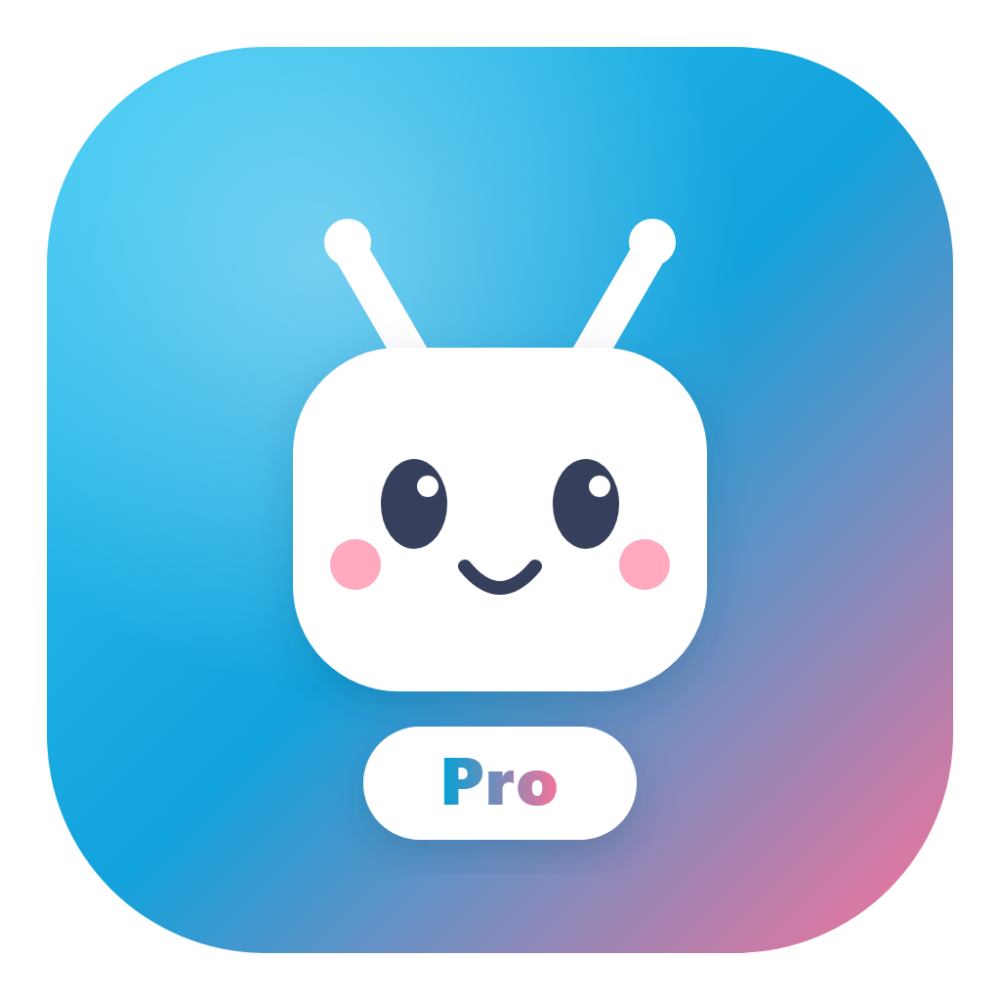
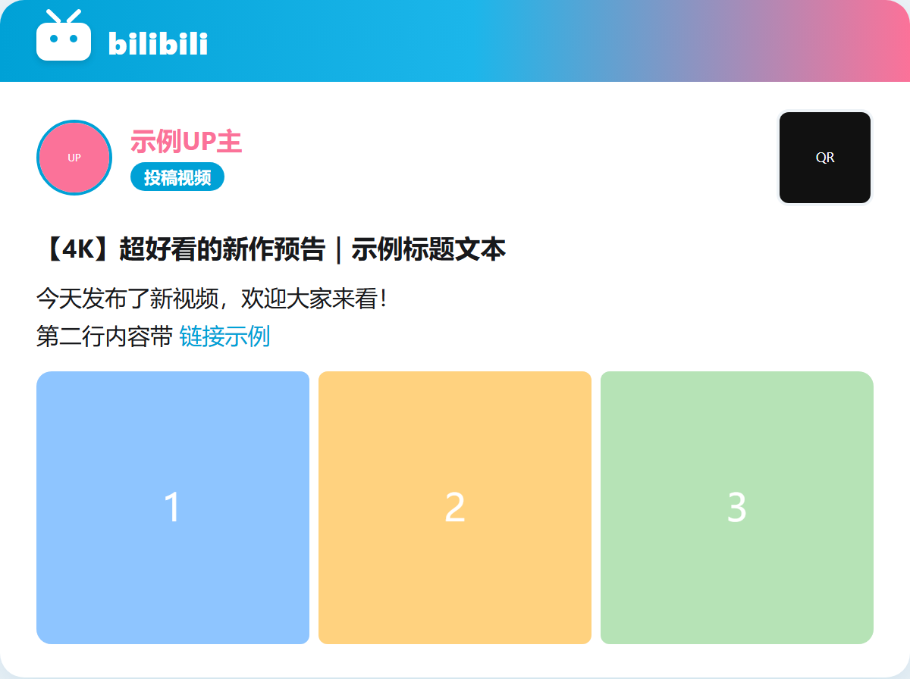
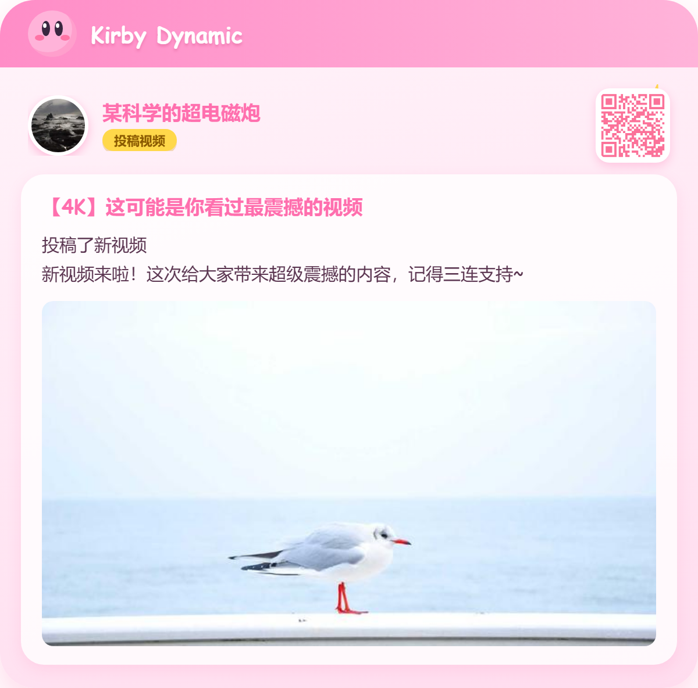
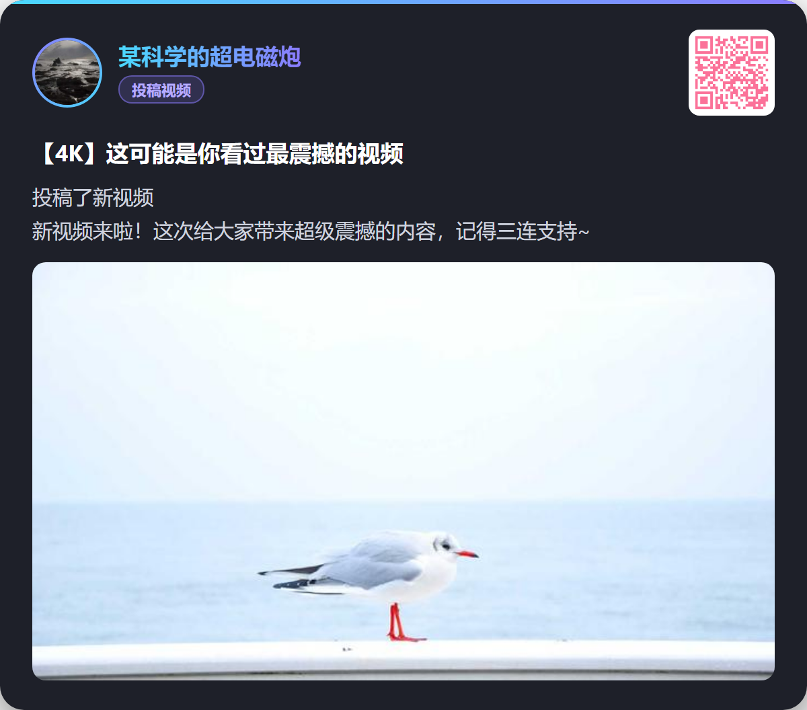
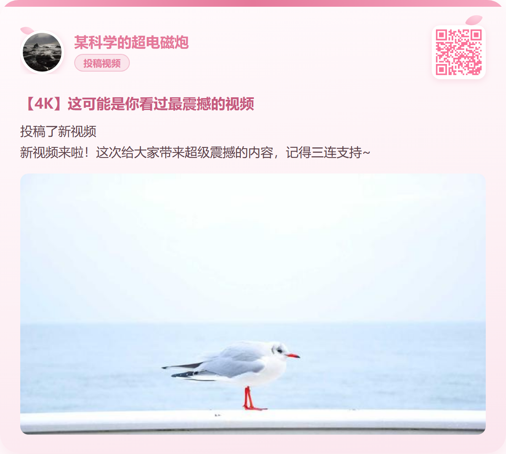
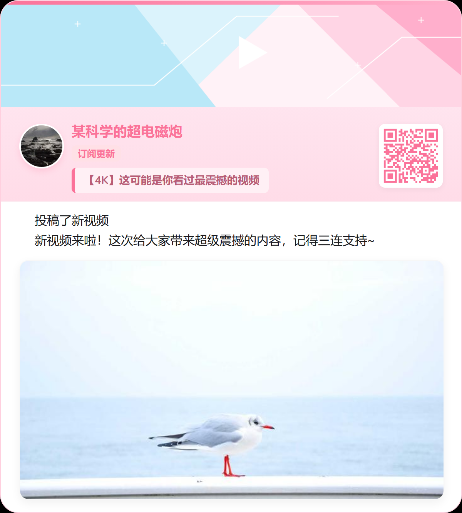
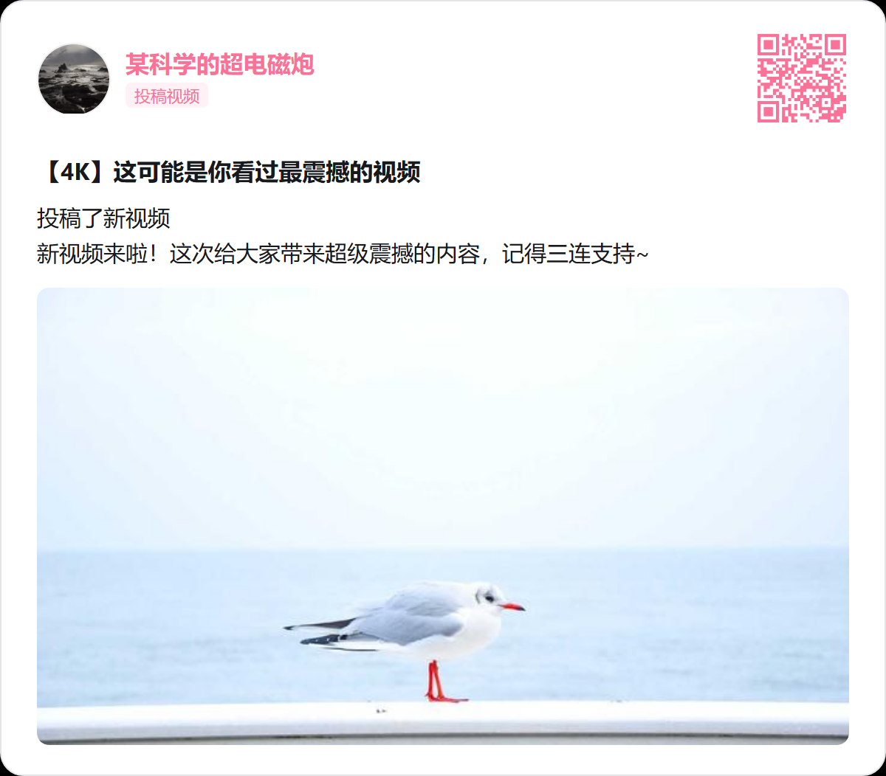
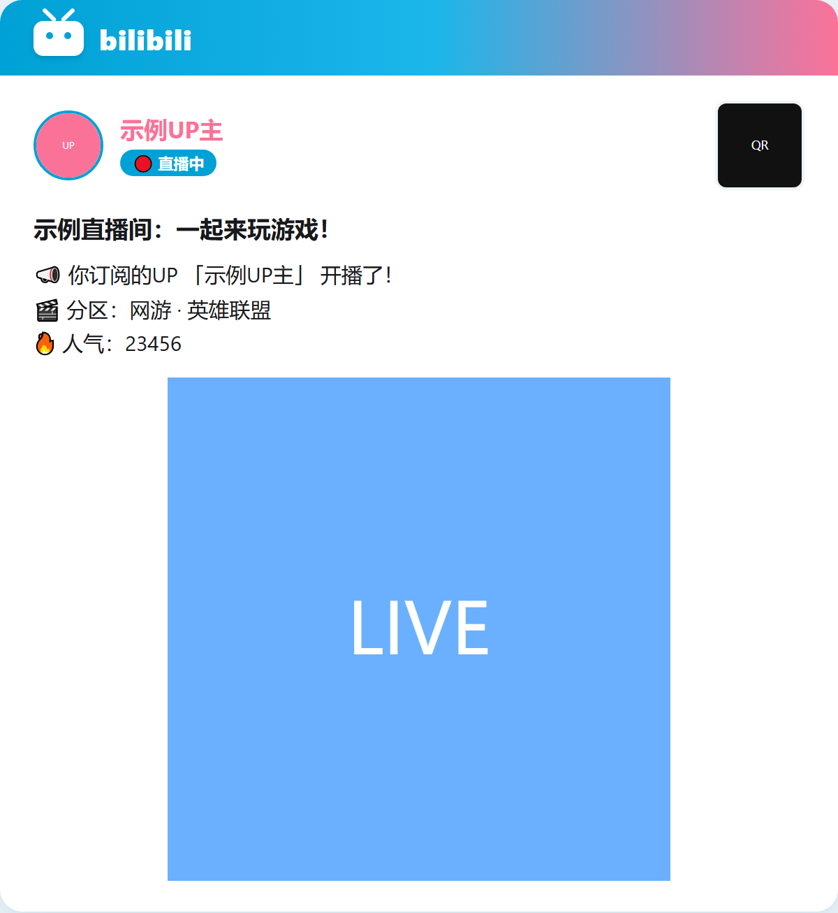

<div align="center">



# Bilibili Pro

**哔哩哔哩动态推送 · 直播开播提醒 · 视频 / 小程序解析 · 番剧智能推荐**

为 [AstrBot](https://github.com/AstrBotDevs/AstrBot) 打造的全能哔哩哔哩插件，内置 7 款精美卡片皮肤。


</div>

---

> 💡 **这是什么？**
>
> **Bilibili Pro** 是在 [Soulter/astrbot_plugin_bilibili](https://github.com/Soulter/astrbot_plugin_bilibili) 原版基础上的社区增强版（fork）。它完整保留了原插件的全部指令与用法，并在**直播推送、卡片皮肤、使用帮助**等方面做了增强。
>
> ✅ **指令与原版完全一致**，你可以先卸载原插件，再安装本插件无缝衔接；首次运行时会**自动迁移**原插件已有的订阅数据，无需重新订阅。

## ✨ 功能亮点

- 🎬 **UP 主动态订阅**：投稿视频、图文、专栏、转发、抽奖等动态实时推送，支持按类型与正则关键词灵活过滤。
- 🔴 **直播开播 / 下播提醒**：开播通知自动附带**直播分区**与**人气值**，下播播报**本场直播时长**，并可单独过滤下播提醒。
- 🔗 **视频解析**：自动识别 `BV` 号、`b23.tv` 短链与视频链接，返回封面、标题与数据卡片。
- 📱 **QQ 小程序解析**：自动提取 QQ 聊天中分享的 B 站小程序直链。
- 🧠 **番剧智能推荐**：接入 LLM 后，用自然语言即可获取番剧推荐（支持类别、起止年份、季度），例如「推荐一些 2016 年之后的催泪番剧」。
- 🎨 **7 款卡片皮肤**：经典、B站粉、简约，以及全新设计的 **哔哩哔哩**、**星之卡比**、**暗夜霓虹**、**樱花** 四款皮肤，可一键切换且无水印。
- 📷 **扫码登录**：`/bili_login` 二维码登录，比仅填 SESSDATA 更稳定，有效缓解 412 风控。
- 🌐 **订阅管理页面**：AstrBot WebUI 内集中查看、新增、编辑、删除订阅，并支持上传自定义渲染头像。
- 🆘 **一键帮助**：发送 `/bili` 即可查看全部指令。

## 🖼️ 卡片皮肤预览

<table>
  <tr>
    <td align="center"><br/><b>哔哩哔哩</b><br/><code>bilibili</code></td>
    <td align="center"><br/><b>星之卡比</b><br/><code>kirby</code></td>
  </tr>
  <tr>
    <td align="center"><br/><b>暗夜霓虹</b><br/><code>dark</code></td>
    <td align="center"><br/><b>樱花</b><br/><code>sakura</code></td>
  </tr>
  <tr>
    <td align="center"><br/><b>B站粉（默认）</b><br/><code>template_2</code></td>
    <td align="center"><br/><b>简约</b><br/><code>simple</code></td>
  </tr>
</table>

> 直播卡片同样支持全部皮肤，并会显示分区与人气：
>
> 

## 🚀 安装

**方式一：通过仓库地址安装**（推荐）在 AstrBot WebUI 的插件管理页选择「通过链接安装」，填写：

```text
https://github.com/Whereis-Alice/astrbot_plugin_bilibili_pro
```

**方式二：通过指令安装**

```shell
plugin i https://github.com/Whereis-Alice/astrbot_plugin_bilibili_pro
```

安装后请确保已安装依赖（AstrBot 通常会自动处理 `requirements.txt`）。

### 从原插件平滑升级

1. 备份原插件的订阅数据与配置，再卸载原 `astrbot_plugin_bilibili` 插件。卸载时保留原插件数据目录。
2. 安装本插件 `astrbot_plugin_bilibili_pro`。
3. 启动本插件。首次加载时，如果旧订阅文件仍存在且本插件尚无数据文件，会**自动复制迁移**订阅与已保存的登录凭据，原文件不会被删除。
4. 核对本插件的配置。原插件配置页中填写的 SESSDATA、代理、轮询周期等不会自动迁移，需要重新填写；可用 `/bili_sub_list` 检查订阅。

## ⚙️ 配置

插件至少需要配置 `sessdata` 才能正常获取 Bilibili 数据，两种方式二选一：

1. **手动填写**：参考 [此指南](https://nemo2011.github.io/bilibili-api/#/get-credential) 获取 `sessdata`，填入插件配置。
2. **扫码登录**（推荐）：管理员在私聊中发送 `/bili_login`，使用 Bilibili App 扫码即可自动获取并保存凭据。此方式更稳定，可缓解 412 问题。**不建议使用主账号登录。**

其余配置项（轮询周期、代理、渲染模板、动态推送上限等）均可在插件配置页中按需调整。

### 卡片外观

| 配置项 | 默认值 | 说明 |
| :--- | :--- | :--- |
| `renderer_template` | `template_2` | 全局卡片皮肤，也可用 `/bili_card_style` 切换。 |
| `card_border`（卡片外框） | 关闭 | 关闭时移除卡片外围留白、背景与描边，保留卡片圆角；开启时恢复带留白的外框效果。适用于全部 7 款皮肤。 |
| `rai`（图片推送） | 开启 | 关闭后以纯文本发送动态和直播通知，外观设置不再影响推送。 |

订阅成功、视频查询与直播通知使用的默认头像为**爱丽丝**，默认显示名也是**爱丽丝**；UP 主动态卡片仍显示动态作者的头像和名称。已有自定义头像会继续使用，可在订阅管理页点击「恢复默认」切回爱丽丝头像。修改配置后保存并重载插件，使外观设置生效。

## 📖 使用说明

### 快速帮助

随时发送 `/bili` 查看完整指令帮助（所有用户可用）。

### 指令一览

| 指令 | 参数 | 说明 | 别名 |
| :--- | :--- | :--- | :--- |
| `bili` | （无） | 查看完整指令帮助。 | （无） |
| `bili_sub` | `<UID> [过滤器...]` | 订阅指定 UP 主的动态与开播提醒，可追加多个过滤器（空格分隔）。 | `订阅动态` |
| `bili_sub_list` | （无） | 显示当前会话的所有订阅。 | `订阅列表` |
| `bili_sub_del` | `<UID>` | 删除当前会话对指定 UP 主的订阅。 | `订阅删除` |
| `bili_sub_test` | `<UID>` | 获取最近可渲染的动态并发送测试卡片；忽略已推送缓存，不保存订阅。 | `订阅测试` |
| `bili_card_style` | `[皮肤名]` | **[管理员]** 切换卡片皮肤；不带参数查看全部皮肤。 | `卡片样式` |
| `bili_login` | （无） | **[管理员]** 私聊内扫码登录。 | （无） |
| `bili_logout` | （无） | **[管理员]** 注销登录并删除本地凭据。 | （无） |
| `bili_global_sub` | `<UMO> <UID> [过滤器...]` | **[管理员]** 为指定会话添加订阅。建议用「」包裹 UMO。 | `全局订阅` |
| `bili_global_del` | `<UMO>` | **[管理员]** 删除指定会话的所有订阅。 | `全局删除` |
| `bili_global_list` | （无） | **[管理员]** 查看所有会话的订阅情况。 | `全局列表` |

> 另外，直接发送 `BV` 号 / `b23.tv` 短链 / 视频链接，或 B 站 QQ 小程序卡片，插件会自动解析，无需指令。

### 过滤器（订阅时追加，命中则不推送）

| 关键字 | 含义 |
| :--- | :--- |
| `forward` | 过滤转发动态 |
| `lottery` | 过滤互动抽奖动态 |
| `video` | 过滤投稿视频动态 |
| `article` | 过滤专栏动态 |
| `draw` | 过滤图文动态 |
| `live` | 过滤开播与下播提醒 |
| `live_end` | 仅过滤下播提醒（保留开播） |
| `forward_lottery` | 过滤转发的互动抽奖动态 |
| **正则表达式** | 其他任意字符串会作为正则，用于过滤动态文本内容 |

### @ 提醒选项（订阅时追加）

| 选项 | 含义 |
| :--- | :--- |
| `live_atall` | 仅在该 UP 主**开播**时尝试 @全体成员 |
| `at_all` | 发布动态或开播时尝试 @全体成员 |
| `at_sub` | 把当前用户加入专属提醒，推送时 @该用户 |
| `unat_sub` | 取消当前用户对该 UP 主的专属 @提醒 |

> **⚠️ 注意**：使用 @全体成员（`at_all` / `live_atall`）需要指令发送者与机器人均具备群管理员权限，否则会降级为普通推送；为避免打扰，**下播**时不会触发任何 @ 提醒。

**示例**：`/订阅动态 123456 lottery live_atall 关注`
订阅 UID 为 `123456` 的 UP 主，过滤抽奖动态与含「关注」二字的动态，并在其开播时 @全体成员。再次执行同一指令可更新过滤条件。

### 卡片皮肤切换

发送 `/bili_card_style` 查看全部皮肤，`/bili_card_style <皮肤名>` 切换，例如 `/bili_card_style kirby`。

| 皮肤名（key） | 名称 | 风格说明 |
| :--- | :--- | :--- |
| `template_1` | 经典风格 | 原版设计 |
| `template_2` | B站粉风格 | **默认皮肤**，B 站粉主题 |
| `simple` | 简约风格 | 简洁现代 |
| `bilibili` | 哔哩哔哩风格 | 仿 B 站蓝粉渐变，顶部品牌栏 |
| `kirby` | 星之卡比风格 | 卡比头像、粉彩星星、圆润可爱 |
| `dark` | 暗夜霓虹 | 深色霓虹渐变，适合夜间 |
| `sakura` | 樱花 | 柔和樱花粉，清新治愈 |

### 订阅管理页面

AstrBot `>= 4.26.0` 可在 WebUI 的「插件详情 → 订阅管理」打开 Plugin Page，集中管理会话订阅，并支持上传自定义渲染头像（图片保存在插件数据目录，可随时恢复默认）。

### 测试动态与直播提醒

发送 `/bili_sub_test <UID>` 测试动态获取与渲染，例如 `/bili_sub_test 192360`。命令优先选择接口返回的最新非置顶动态；没有可用的非置顶动态时，再尝试置顶动态。已订阅时仍会应用该会话的类型和关键词过滤规则。

测试命令**没有“最近一天”限制**，也不会因为某条动态已推送过而跳过它。正常后台推送会根据已记录的动态 ID 去重；测试不会推进这个记录。如果测试仍提示没有可渲染的动态，请检查账号是否公开发布了动态、过滤规则、当前动态类型以及登录凭据和 API 返回结果。

直播提醒在订阅后自动轮询，无需额外命令。默认每个 UP 主约 5 分钟检查一次，多账号订阅还会受任务间隔影响。只有状态变为开播或下播时才通知，持续直播不会反复推送；发送失败时，下次轮询会重试仍未送达的状态变化。`live` 过滤开播和下播，`live_end` 仅过滤下播；下播不会触发 @提醒。`/bili_sub_test` 测试的是动态卡片，不会模拟开播通知。

## ❓ 常见问题

1. **渲染图片失败**：通常是公共接口不稳定所致，详见 [issue43](https://github.com/Soulter/astrbot_plugin_bilibili/issues/43)。
2. **错误代码 -352 / 412**：参考 [issue34](https://github.com/Soulter/astrbot_plugin_bilibili/issues/34)、[issue58](https://github.com/Soulter/astrbot_plugin_bilibili/issues/58)、[issue72](https://github.com/Soulter/astrbot_plugin_bilibili/issues/72)，推荐使用 `/bili_login` 扫码登录。
3. **AstrBot 升级到 4.0 后订阅失效**：UMO 结构发生变化，使用 `/全局列表` 查看后重新订阅即可；也可进入 `data/plugin_data/astrbot_plugin_bilibili_pro` 目录手动调整 UMO。
4. **新模板发不出图片**：图文动态采用纵向布局，图片过长时受 QQ 机制限制需以文件形式发送，可能需要在 AstrBot「系统配置」中配置「对外可达的回调接口地址」。
5. **图片被错误裁剪或有多余区域**：推荐 [自部署 t2i](https://docs.astrbot.app/others/self-host-t2i.html) 并及时更新镜像。

## 🧩 模板开发

```bash
# 启动 UI 开发模式（在插件根目录运行）
cd astrbot_plugin_bilibili_pro
python dev_ui.py
```

卡片模板位于 `assets/` 目录，新增模板后在 `core/constant.py` 的 `CARD_TEMPLATES` 中注册即可。[astrbot-t2i-playground](https://github.com/AstrBotDevs/astrbot-t2i-playground) 也可帮助调试模板。

## 🙏 致谢

- 原插件作者 [Soulter](https://github.com/Soulter) 与 [Flartiny](https://github.com/Flartiny)，本项目基于其 [astrbot_plugin_bilibili](https://github.com/Soulter/astrbot_plugin_bilibili) 增强而来。
- 卡片模板设计与模板管理机制 [@ocetars](https://github.com/ocetars)。
- [AstrBot](https://github.com/AstrBotDevs/AstrBot) 与 [bilibili-api](https://github.com/Nemo2011/bilibili-api)。

## 📄 许可证

本项目以 [MIT](LICENSE) 许可证开源，版权归原作者及本 fork 维护者所有。

## 📝 更新日志

见 [CHANGELOG.md](CHANGELOG.md)。
